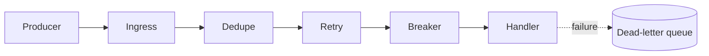

# FluxMesh

[](https://github.com/borikhan/fluxmesh/actions/workflows/ci.yml)
[](https://go.dev/)

Resilience primitives for at-least-once event processing in Go. FluxMesh composes bounded exponential retries, a circuit breaker, time-window deduplication, cancellation propagation, and an HTTP ingestion process behind a deliberately small API.

## Why it is interesting

- Duplicate delivery becomes a first-class condition, not an edge-case comment
- Retry budgets respect context cancellation and cap exponential delay
- Circuit breaking prevents a failing dependency from consuming the whole worker pool
- Components are independently testable and safe for concurrent use
- The process exposes health, emits structured logs, and ships as a non-root container



## Quick start

```bash
go test -race ./...
go run ./cmd/worker
curl -i -X POST localhost:8080/v1/messages \
  -H 'content-type: application/json' \
  -d '{"ID":"evt-42","Topic":"billing.created","Payload":"e30="}'
```

The in-memory deduper is ideal for unit tests and a single local process. Production topology uses an external idempotency store and durable broker without changing handler semantics.

Read [architecture and operations](docs/architecture.md) for failure policy, scale-out, and twelve-factor compliance.

## License

MIT
